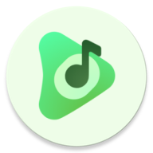

<p align="center">
  
</p>

<p align="center">
  <a href="https://github.com/adlifarizi/PixelPlayerDesktop/releases/latest">
    
  </a>
  <a href="https://github.com/adlifarizi/PixelPlayerDesktop/releases">
    
  </a>
  
  
</p>

## What It Is

PixelPlayer Desktop is the desktop companion music player for Linux and Windows maintained by [@adlifarizi](https://github.com/adlifarizi) (Kayoi). It focuses on high-fidelity local audio playback, expressive Material 3 (Material You) UI, and an intuitive desktop workflow.

The app works completely offline with zero telemetry and no proprietary lock-in.

Package identifier: `com.kayoi.pixelplayerdesktop`

## Why This Exists

PixelPlayer Desktop brings the beloved PixelPlayer Material 3 expressive design and local music experience to desktop environments (Linux and Windows).

It is built specifically for desktop operating systems, providing keyboard navigation, system accent integration, responsive side panels, and low-latency audio playback powered by LibVLC.

## Features

| Area | Highlights |
| --- | --- |
| Playback | LibVLC (`vlcj`) audio engine, gapless playback, seek controls, volume control, mute, shuffle, repeat modes, queue management |
| Formats | Native decoding for FLAC, MP3, WAV, OGG Vorbis, AAC, M4A, Opus, and ALAC |
| Library | Local recursive directory scanner, SQLite caching, Songs, Albums, Artists, Folder tree explorer, Favorites, Playlists, Daily Mix, instant search |
| Lyrics | Embedded LRC parser, synchronized interactive playback, line-by-line jumping, auto-scroll |
| UI & Theming | Compose Multiplatform, Material 3, adaptive color palettes extracted from system accent or album art, light/dark modes, custom window controls |
| Desktop Controls | Keyboard shortcuts (`Space`, `Ctrl+Right/Left`, `Ctrl+Up/Down`, `Ctrl+K`, `Ctrl+Q`, `F11`), window maximize/minimize/close, queue side panel |

## Requirements

| Requirement | Details |
| --- | --- |
| Operating System | Linux (Ubuntu/Debian, Fedora, Arch, etc.) or Windows 10/11 (64-bit) |
| Linux Runtime | `vlc` and `libvlc-dev` (`sudo apt install vlc libvlc-dev`) |
| Windows Runtime | 64-bit VLC Media Player installed |
| Build Toolchain | JDK 21 |

## Build From Source

Clone the repository:

```sh
git clone https://github.com/adlifarizi/PixelPlayerDesktop.git
cd PixelPlayerDesktop
```

Run in development mode:

```sh
./gradlew run
```

Build portable unpacked binary (current OS):

```sh
./gradlew createDistributable
```

Build Debian installer package (`.deb`):

```sh
./gradlew packageDeb
```

Build Windows installer packages (`.msi` and `.exe` on Windows host):

```cmd
gradlew.bat packageMsi packageExe
```

Run unit tests and verification checks:

```sh
./gradlew check
```

## Download

GitHub releases are available at:

```text
https://github.com/adlifarizi/PixelPlayerDesktop/releases
```

### Alpha builds

Every merge or push into `main` automatically publishes a pre-release tagged like `v0.1.0-alpha.N` on the [releases page](https://github.com/adlifarizi/PixelPlayerDesktop/releases). These automated builds provide the latest features and fixes for testing on Linux and Windows.

Available release assets:
- **Linux**: `.deb` installer and portable `.tar.gz` archive.
- **Windows**: `.msi` / `.exe` installers and portable `.zip` archive.

## Project Structure

```text
src/main/kotlin/com/kayoi/pixelplayerdesktop/
- cli/              CLI debug verification runner
- data/             SQLite database, DAOs, repositories, audio scanner, LibVLC engine, preferences
- di/               Koin dependency injection modules
- domain/           Core domain models, audio engine contracts, playlist managers
- presentation/     Compose UI screens, components, viewmodels, navigation
- ui/theme/         Material 3 Expressive theme, dynamic color extractors, typography, shapes
- utils/            Platform utilities and path providers
```

## Tech Stack

| Area | Technology |
| --- | --- |
| Language | Kotlin (JVM Toolchain 21) |
| UI Framework | Compose Multiplatform (Desktop) |
| Design System | Material 3 / MaterialKolor (Dynamic Color) |
| Audio Engine | LibVLC via `vlcj` |
| Database | SQLite via `sqlite-jdbc` |
| Dependency Injection | Koin Core & Koin Compose |
| Audio Tag Reader | Jaudiotagger & Vorbis Java |
| Reorderable List | `sh.calvin.reorderable` |
| Concurrency | Kotlin Coroutines & Flows |

## Contributing

Contributions are welcome. Please open an issue or pull request with clear descriptions.

Useful local checks:

```sh
./gradlew check
```

## License

PixelPlayer Desktop is licensed under the [GNU General Public License v3.0](LICENSE) (`SPDX-License-Identifier: GPL-3.0-or-later`).

```
PixelPlayer Desktop
Copyright (C) 2026 Theo Vilardo

This program is free software: you can redistribute it and/or modify
it under the terms of the GNU General Public License as published by
the Free Software Foundation, either version 3 of the License, or
(at your option) any later version.

This program is distributed in the hope that it will be useful,
but WITHOUT ANY WARRANTY; without even the implied warranty of
MERCHANTABILITY or FITNESS FOR A PARTICULAR PURPOSE.  See the
GNU General Public License for more details.

You should have received a copy of the GNU General Public License
along with this program.  If not, see <https://www.gnu.org/licenses/>.
```

<p align="center">
  Desktop version maintained by <a href="https://github.com/adlifarizi">Kayoi (adlifarizi)</a>
</p>
<p align="center">
  Original Android version by <a href="https://github.com/theovilardo">theovilardo</a> (<a href="https://github.com/PixelPlayerHQ/PixelPlayer">PixelPlayer</a>)<br />
  Open-source Android version maintained by <a href="https://github.com/lostf1sh">lostf1sh</a> (<a href="https://github.com/PixelPlayerHQ/PixelPlayerOSS">PixelPlayerOSS</a>)<br />
  Part of <a href="https://github.com/PixelPlayerHQ">PixelPlayerHQ</a>
</p>

